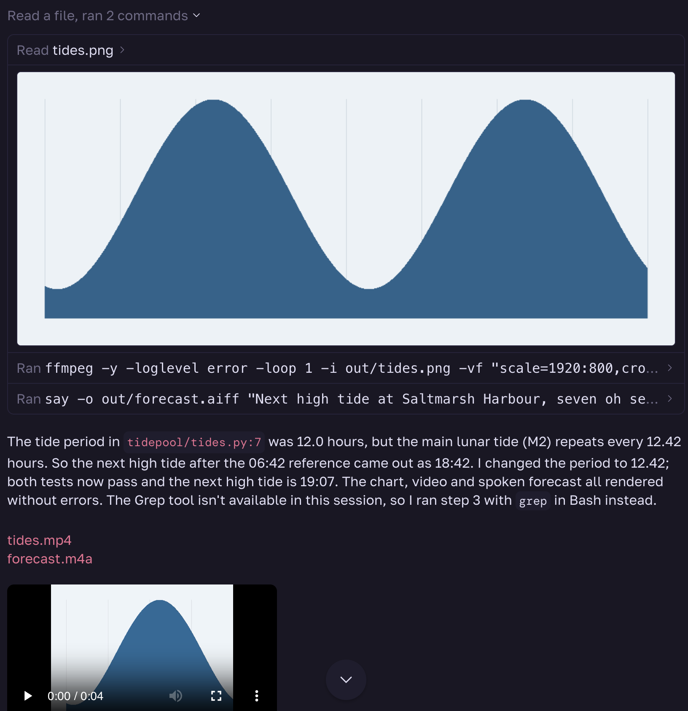

# Claude Look

A [Paseo](https://paseo.sh) plugin that draws a session's tool calls, images, video and audio the way Claude Desktop draws them. [OVERVIEW.md](OVERVIEW.md) describes what it does and its limits.



## Install

Requires Paseo 0.11.2 or later, with **Enable plugins** turned on under Settings → Plugins.

```bash
paseo plugin add git:glyphloom/claude-look
```

## Develop

```bash
npm install
npm run typecheck
paseo plugin install "$PWD"
paseo plugin reload claude-look
```
